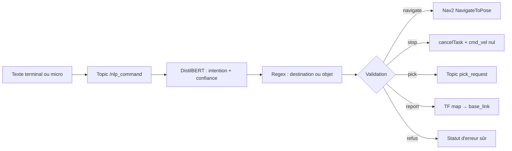

# NLP Robot Commander

Projet HESTIM de commande d'un robot mobile par langage naturel. Une phrase française est classée parmi quatre intentions (`navigate`, `stop`, `pick`, `report`), ses paramètres sont extraits, puis l'action correspondante est transmise à ROS 2/Nav2.

> Les coordonnées de `config/waypoints.yaml` sont des exemples. Relevez et remplacez-les dans RViz2 avant toute démonstration notée.

## Architecture



Le cœur NLP est indépendant de ROS 2. Il est donc testable sur Windows; l'intégration robotique s'exécute sous Ubuntu 22.04 avec ROS 2 Humble.

## Contenu du dépôt

| Chemin | Rôle |
|---|---|
| `dataset/dataset.csv` | 80 phrases d'entraînement, 20 par intention |
| `dataset/test_commands.csv` | 50 commandes inédites pour la campagne finale |
| `scripts/train_intent_classifier.py` | Fine-tuning et validation DistilBERT |
| `scripts/evaluate_intent_classifier.py` | Test indépendant, métriques et matrice de confusion |
| `scripts/analyze_failure_modes.py` | Catalogue automatique des erreurs observées |
| `src/nlp_robot_commander` | Package ROS 2 `ament_python` |
| `tests` | Tests du dataset, des règles et de l'extraction |
| `docs` | Proposition, protocole, architecture et rapport |

## 1. Installation NLP

Python 3.10 est recommandé, car c'est la version système d'Ubuntu 22.04 et de ROS 2 Humble.

```bash
python3.10 -m venv .venv
source .venv/bin/activate
python -m pip install --upgrade pip
pip install -r requirements-dev.txt
pip install -e src/nlp_robot_commander
pytest
```

Sous Windows, remplacez l'activation par `.venv\Scripts\activate`. Le cœur NLP fonctionne, mais ROS 2 Humble/Gazebo doit être exécuté sous Ubuntu 22.04.

## 2. Entraînement DistilBERT

Le modèle par défaut, `distilbert-base-multilingual-cased`, prend en charge le français.

```bash
python scripts/train_intent_classifier.py \
  --dataset dataset/dataset.csv \
  --output-dir models/distilbert-robot-commander-20ep \
  --artifacts-dir artifacts/training_20ep \
  --epochs 20
```

Le script effectue un split stratifié 80/20 avec la graine 42. Il produit le checkpoint, les deux splits exacts, `validation_metrics.json` et `confusion_matrix.png`. L'objectif de 90 % est évalué, jamais présumé. Avec seulement 16 exemples de validation, le score doit être accompagné des résultats sur les 50 commandes inédites.

Démo locale sans ROS 2 :

```bash
python scripts/demo_pipeline.py --model models/distilbert-robot-commander-20ep
```

Sans `--model`, le script utilise uniquement le classifieur lexical de secours.

## 3. Évaluation sur les 50 commandes

```bash
python scripts/evaluate_intent_classifier.py \
  --model models/distilbert-robot-commander-20ep \
  --dataset dataset/test_commands.csv \
  --output-dir artifacts/test_campaign_20ep
python scripts/analyze_failure_modes.py \
  --predictions artifacts/test_campaign_20ep/predictions.csv \
  --output artifacts/test_campaign_20ep/failure_catalogue.md
```

Les sorties sont écrites dans `artifacts/test_campaign_20ep/`. Pour évaluer Nav2, renseignez la colonne `nav_result` (`succeeded`, `failed`, `aborted` ou `inaccessible`) dans une copie de `predictions.csv`, puis relancez l'analyse des pannes.

## 4. Installation ROS 2 Humble et TurtleBot3

Installez d'abord ROS 2 Humble, Nav2 et TurtleBot3 selon leur documentation officielle, puis dans un terminal Ubuntu :

```bash
sudo apt update
sudo apt install ros-humble-navigation2 ros-humble-nav2-bringup \
  ros-humble-turtlebot3-gazebo ros-humble-turtlebot3-navigation2 \
  python3-colcon-common-extensions

source /opt/ros/humble/setup.bash
python3 -m venv --system-site-packages .venv
source .venv/bin/activate
pip install -r requirements.txt
pip install -e src/nlp_robot_commander
colcon build --symlink-install
source install/setup.bash
```

## 5. Simulation et commande

Lancez le monde TurtleBot3, Nav2 et le commander :

```bash
source /opt/ros/humble/setup.bash
source install/setup.bash
ros2 launch nlp_robot_commander simulation.launch.py
```

Si Nav2 est déjà lancé avec votre propre carte :

```bash
ros2 launch nlp_robot_commander nlp_commander.launch.py
```

Dans un autre terminal, ouvrez le client interactif :

```bash
source install/setup.bash
ros2 run nlp_robot_commander terminal_client
```

Exemples : `Rends-toi dans la cuisine`, `Arrête-toi`, `Prends la boîte rouge`, `Où es-tu ?`.

Pour voir les décisions et résultats :

```bash
ros2 topic echo /nlp_commander/status
```

Pour forcer le secours lexical si le checkpoint n'est pas disponible :

```bash
ros2 run nlp_robot_commander nlp_commander --ros-args \
  -p classifier_backend:=rules \
  -p waypoints_file:=$(pwd)/src/nlp_robot_commander/config/waypoints.yaml
```

## 6. Calibrage des waypoints

1. Dans RViz2, placez le robot dans chaque pièce.
2. Lisez la pose avec `ros2 topic echo /amcl_pose --once`.
3. Reportez `x`, `y` et le lacet (`yaw`) dans `src/nlp_robot_commander/config/waypoints.yaml`.
4. Vérifiez chaque point avec Nav2 avant de tester une phrase NLP.
5. Conservez la carte, la configuration et les coordonnées utilisées pour la soutenance.

## Sécurité et limites

- Une commande sous le seuil de confiance est refusée.
- Une destination absente des waypoints n'est jamais envoyée à Nav2.
- `stop` annule la tâche Nav2 et publie une vitesse nulle.
- `pick` publie une requête : aucune préhension réelle n'est affirmée sans manipulateur abonné.
- Les commandes à plusieurs intentions suivent une politique « première intention » seulement dans le secours lexical; elles doivent être analysées séparément avec le modèle entraîné.

## Livrables HESTIM

- [Fiche de proposition](docs/proposition_hestim.md)
- [Architecture technique](docs/architecture.md)
- [Protocole des 50 tests](docs/test_protocol.md)
- [Catalogue des modes d'échec](docs/failure_mode_catalogue.md)
- [Rapport technique final](docs/rapport_technique.md)
- [Plan de soutenance et vidéo](docs/soutenance.md)

