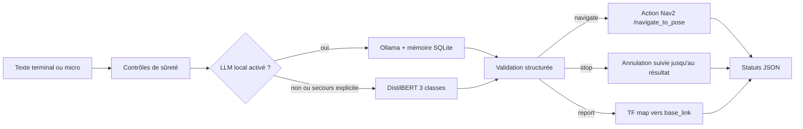
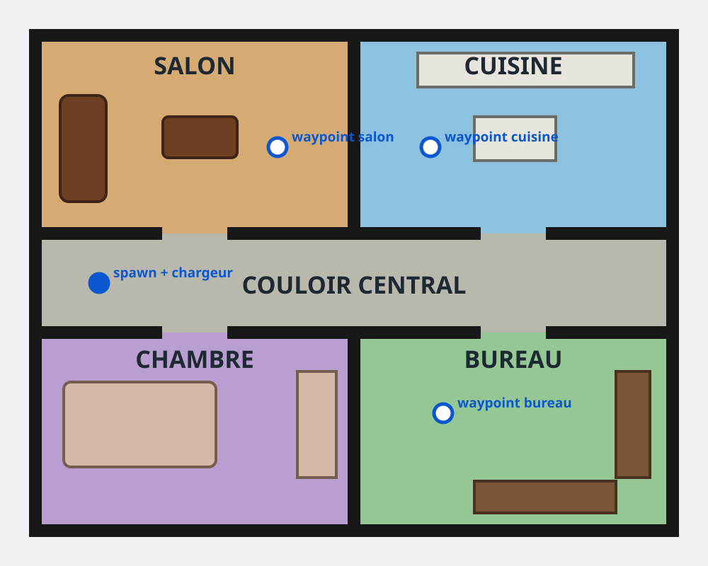

# NLP Robot Commander

Prototype HESTIM de commande d’un robot mobile TurtleBot3 par phrases françaises. Le système reconnaît exactement trois intentions :

| Intention | Exemple | Effet |
|---|---|---|
| `navigate` | « Rends-toi dans la cuisine » | Envoie un but `NavigateToPose` vers un waypoint autorisé |
| `stop` | « Arrête-toi immédiatement » | Demande l’annulation du but et attend le résultat Nav2 |
| `report` | « Où te trouves-tu ? » | Lit une transformation TF récente `map → base_link` |

Toute commande vide, trop longue, niée, séquentielle, ambiguë, hors domaine ou visant une destination inconnue est refusée. Un arrêt explicite non nié a priorité sur les autres mots de la phrase.

## Résultats mesurés

Mesures du 22 octobre 2026, graine 42 :

| Jeu | Taille | Accuracy | F1 macro | Remarque |
|---|---:|---:|---:|---|
| Validation figée | 36 | 97,22 % | 97,22 % | Meilleur checkpoint parmi 12 époques |
| Test indépendant | 45 | 100,00 % | 100,00 % | 15 phrases par intention |
| Sûreté/adversarial | 15 | 100,00 % | — | 15 décisions conformes attendues |

Ces résultats évaluent le NLP et le pipeline de décision local. Ils ne prouvent pas le succès d’une navigation réelle. Gazebo, Nav2, TF et l’arrêt physique doivent être validés sur Ubuntu avec les procédures de [`docs/checklist_demo.md`](docs/checklist_demo.md) et [`docs/ACTIONS_MANUELLES.md`](docs/ACTIONS_MANUELLES.md).

## Architecture



Le classifieur lexical est un mode de secours explicite. Il est désactivé par défaut afin qu’un checkpoint manquant ou corrompu ne soit jamais masqué silencieusement.

Le LLM est une extension locale et optionnelle. Il ne reçoit aucun accès à ROS 2 : il retourne seulement un JSON contraint, ensuite revérifié par les règles de sûreté et la liste blanche des waypoints. Sa « mémoire » ne modifie pas ses poids. Elle conserve au maximum 200 commandes acceptées dans SQLite et fournit les 8 plus récentes comme contexte. Cela permet par exemple `Va dans la cuisine`, puis `Refais la dernière commande`.

## Arborescence utile

```text
dataset/                         corpus et campagnes indépendantes
scripts/                         audit, entraînement, évaluation, démo locale
src/nlp_robot_commander/         package ROS 2 Python
tests/                           tests NLP, routage et machine d’état
artifacts/training_3intents/      métriques de validation mesurées
artifacts/test_campaign_3intents/ métriques du test indépendant
artifacts/safety_campaign_transformers/ résultats adversariaux
docs/                            rapport, guides et protocoles
```

## Installation recommandée : WSL2 + Ubuntu 22.04

Le runtime de référence est entièrement Linux : Python 3.10, Ollama, SQLite,
ROS 2 Humble, Nav2, Gazebo et RViz2 tournent dans WSL2. Le dépôt doit être
cloné dans `~/projects`, pas sous `/mnt/c`.

Après avoir installé WSL2 et Ubuntu 22.04, ouvrez Ubuntu :

```bash
mkdir -p ~/projects
cd ~/projects
git clone https://github.com/yayaSB/NLP-Robot-Commander.git
cd NLP-Robot-Commander
code .
bash scripts/wsl_setup.sh
```

Le bootstrap installe la pile ROS/NLP, crée un `.venv` compatible avec
`rclpy`, construit le workspace, lance les tests, installe Ollama dans WSL et
télécharge `llama3.2:1b`. Vérification reproductible :

```bash
bash scripts/wsl_check.sh
```

Le guide complet, y compris l’installation de WSL et la migration du
checkpoint, est dans
[`docs/HOW_TO_FIRST_RUN_ON_VSCODE.md`](docs/HOW_TO_FIRST_RUN_ON_VSCODE.md).

## Entraînement et évaluation

```bash
python scripts/train_intent_classifier.py \
  --output-dir models/distilbert-robot-commander-3intents \
  --artifacts-dir artifacts/training_3intents \
  --epochs 12 --batch-size 8 --seed 42

python scripts/evaluate_intent_classifier.py \
  --model models/distilbert-robot-commander-3intents \
  --output-dir artifacts/test_campaign_3intents

python scripts/evaluate_safety_commands.py \
  --model models/distilbert-robot-commander-3intents \
  --output-dir artifacts/safety_campaign_transformers
```

Le dossier `models/` n’est pas versionné : le poids DistilBERT dépasse la limite de taille standard de GitHub. Il faut entraîner localement ou distribuer le checkpoint avec un stockage de modèles approprié.

Démo NLP locale dans WSL :

```bash
bash scripts/wsl_run_demo.sh --clear-memory
```

## LLM local avec mémoire

Le backend utilise l’API locale d’[Ollama](https://docs.ollama.com/api/chat) et ses sorties JSON structurées. Aucun compte ni aucune clé API ne sont nécessaires. Après avoir installé Ollama, téléchargez une fois le petit modèle multilingue :

```bash
ollama pull llama3.2:1b
```

Ollama doit être démarré dans WSL (`ollama serve` si le service systemd ne
fonctionne pas). Le wrapper charge automatiquement DistilBERT lorsqu’il est
présent :

```bash
bash scripts/wsl_run_demo.sh
```

Essayez successivement :

```text
Va dans la cuisine
Refais la dernière commande
```

Le deuxième résultat doit contenir `"source": "memory_rules"`, `"memory_used": true` et `"destination": "cuisine"`. Les références explicites à l’historique sont résolues directement dans SQLite afin de rester fiables même avec un petit LLM. Pour repartir sans historique, ajoutez `--clear-memory` au lancement. La base locale n’est pas versionnée par Git.

## Simulation ROS 2 Humble sous WSL2

Après le bootstrap et la copie ou l’entraînement du checkpoint, reconstruisez
et testez :

```bash
bash scripts/wsl_build.sh
bash scripts/wsl_run_simulation.sh
```

Le lancement par défaut utilise l'appartement fourni avec le projet. Il contient
un couloir central, un salon, une cuisine, une chambre et un bureau séparés par
des murs et des portes de 1,20 m. Dans un second terminal WSL :



Dans Gazebo, le salon est ocre, la cuisine bleue, la chambre violette, le
bureau vert et le couloir gris. Le carré bleu du couloir représente le
chargeur et la pose de départ du robot.

```bash
source scripts/wsl_env.sh
ros2 run nlp_robot_commander terminal_client
```

Le client redessine automatiquement l'invite `> ` après les statuts ROS
asynchrones. Les destinations utilisent des zones d'arrivée sûres centrées juste
derrière les portes afin d'éviter que le contrôleur ne coupe un angle de mur.

Ne lancez qu'une seule instance de `wsl_run_simulation.sh` : le script refuse un
second lancement, car deux stacks Nav2 portant les mêmes noms perturbent les buts.

Pour observer les événements :

```bash
source scripts/wsl_env.sh
ros2 topic echo /nlp_commander/status
```

Le lancement place Gazebo et AMCL à la même pose `(-4.0, 0.0, 0.0)`, sur le
chargeur du couloir, et publie automatiquement `/initialpose` après réception
du premier scan lidar. Les waypoints `salon`, `cuisine`, `bureau` et `chargeur`
sont libres et connectés. Les sols colorés différencient visuellement les
pièces. Pour régénérer les deux assets depuis une définition unique :

```bash
python scripts/generate_apartment_assets.py
```

Une simulation personnalisée doit fournir ensemble sa carte et son monde :

```bash
bash scripts/wsl_run_simulation.sh /chemin/map.yaml /chemin/monde.world
```

## Sémantique de l’arrêt

Les événements distinguent volontairement quatre étapes :

1. `stop_received` : la demande est reçue ;
2. `cancellation_requested` / `cancellation_accepted` : Nav2 traite l’annulation ;
3. `stop_confirmed` : le résultat de l’action est réellement `canceled`, ou aucun but n’était actif ;
4. `stop_unconfirmed` : refus, erreur, expiration du délai ou résultat incompatible.

L’option `publish_zero_velocity_on_stop` est `false` par défaut. Un message nul sur `/cmd_vel` ne constitue jamais une confirmation d’arrêt Nav2 et peut entrer en conflit avec un multiplexeur de vitesse.

## Documentation

- [`output/pptx/NLP_Robot_Commander_Soutenance.pptx`](output/pptx/NLP_Robot_Commander_Soutenance.pptx) : présentation PowerPoint de soutenance avec notes orales ;
- [`NLP_Robot_Commander_Presentation.ipynb`](NLP_Robot_Commander_Presentation.ipynb) : notebook exécutable de démonstration et de présentation des résultats ;
- [`docs/HOW_TO_FIRST_RUN_ON_VSCODE.md`](docs/HOW_TO_FIRST_RUN_ON_VSCODE.md) : installation complète WSL2/Ubuntu 22.04 et lancement dans VS Code ;
- [`docs/rapport_final.md`](docs/rapport_final.md) : rapport technique et audit complet ;
- [`docs/guide_utilisateur.md`](docs/guide_utilisateur.md) : installation et utilisation ;
- [`docs/test_protocol.md`](docs/test_protocol.md) : protocole reproductible ;
- [`docs/failure_mode_catalogue.md`](docs/failure_mode_catalogue.md) : catalogue des modes d’échec ;
- [`docs/checklist_demo.md`](docs/checklist_demo.md) : déroulé de soutenance ;
- [`docs/ACTIONS_MANUELLES.md`](docs/ACTIONS_MANUELLES.md) : validations Gazebo/Nav2 et preuves qui restent manuelles.
- [`output/pdf/rapport_final_nlp_robot_commander.pdf`](output/pdf/rapport_final_nlp_robot_commander.pdf) : rapport PDF vérifié page par page ;
- [`output/presentations/NLP_Robot_Commander_HESTIM_3_intentions.pptx`](output/presentations/NLP_Robot_Commander_HESTIM_3_intentions.pptx) : support de soutenance final.

## Limites

- Les waypoints fournis sont calibrés pour l'appartement du projet et doivent être recalibrés pour toute autre carte.
- Aucun résultat Gazebo/Nav2 n’est inventé : cette validation reste manuelle sur Ubuntu 22.04.
- Le corpus français reste petit ; le score de 100 % sur 45 phrases ne garantit pas la généralisation à toutes les formulations.
- La mémoire fournit du contexte au LLM mais ne réalise pas de réentraînement en ligne. Une sortie LLM reste non déterministe et est toujours filtrée avant routage.
- Si Ollama est indisponible et `llm_fallback_to_classifier` vaut `true`, le statut expose `source: classifier_fallback`. Avec `false`, la commande est refusée avec `LLM_UNAVAILABLE`.
- L’entrée micro repose sur un service externe si `SpeechRecognition` est utilisé.

Licence MIT.
