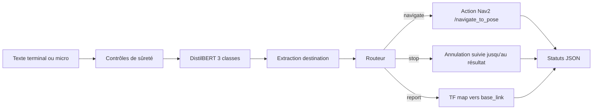

# NLP Robot Commander

Prototype HESTIM de commande d’un robot mobile TurtleBot3 par phrases françaises. Le système reconnaît exactement trois intentions :

| Intention | Exemple | Effet |
|---|---|---|
| `navigate` | « Rends-toi dans la cuisine » | Envoie un but `NavigateToPose` vers un waypoint autorisé |
| `stop` | « Arrête-toi immédiatement » | Demande l’annulation du but et attend le résultat Nav2 |
| `report` | « Où te trouves-tu ? » | Lit une transformation TF récente `map → base_link` |

Toute commande vide, trop longue, niée, séquentielle, ambiguë, hors domaine ou visant une destination inconnue est refusée. Un arrêt explicite non nié a priorité sur les autres mots de la phrase.

## Résultats mesurés

Mesures du 22 octobre 2026, graine 42 :

| Jeu | Taille | Accuracy | F1 macro | Remarque |
|---|---:|---:|---:|---|
| Validation figée | 36 | 97,22 % | 97,22 % | Meilleur checkpoint parmi 12 époques |
| Test indépendant | 45 | 100,00 % | 100,00 % | 15 phrases par intention |
| Sûreté/adversarial | 15 | 100,00 % | — | 15 décisions conformes attendues |

Ces résultats évaluent le NLP et le pipeline de décision local. Ils ne prouvent pas le succès d’une navigation réelle. Gazebo, Nav2, TF et l’arrêt physique doivent être validés sur Ubuntu avec les procédures de [`docs/checklist_demo.md`](docs/checklist_demo.md) et [`docs/ACTIONS_MANUELLES.md`](docs/ACTIONS_MANUELLES.md).

## Architecture



Le classifieur lexical est un mode de secours explicite. Il est désactivé par défaut afin qu’un checkpoint manquant ou corrompu ne soit jamais masqué silencieusement.

## Arborescence utile

```text
dataset/                         corpus et campagnes indépendantes
scripts/                         audit, entraînement, évaluation, démo locale
src/nlp_robot_commander/         package ROS 2 Python
tests/                           tests NLP, routage et machine d’état
artifacts/training_3intents/      métriques de validation mesurées
artifacts/test_campaign_3intents/ métriques du test indépendant
artifacts/safety_campaign_transformers/ résultats adversariaux
docs/                            rapport, guides et protocoles
```

## Installation NLP

Python 3.10 est recommandé pour rester aligné avec ROS 2 Humble.

```bash
python3 -m venv .venv
source .venv/bin/activate
python -m pip install --upgrade pip
python -m pip install -r requirements-dev.txt
```

Audit des données et tests rapides :

```bash
python scripts/audit_dataset.py --output artifacts/dataset_audit.json
python -m pytest
python -m compileall -q scripts src tests
```

## Entraînement et évaluation

```bash
python scripts/train_intent_classifier.py \
  --output-dir models/distilbert-robot-commander-3intents \
  --artifacts-dir artifacts/training_3intents \
  --epochs 12 --batch-size 8 --seed 42

python scripts/evaluate_intent_classifier.py \
  --model models/distilbert-robot-commander-3intents \
  --output-dir artifacts/test_campaign_3intents

python scripts/evaluate_safety_commands.py \
  --model models/distilbert-robot-commander-3intents \
  --output-dir artifacts/safety_campaign_transformers
```

Le dossier `models/` n’est pas versionné : le poids DistilBERT dépasse la limite de taille standard de GitHub. Il faut entraîner localement ou distribuer le checkpoint avec un stockage de modèles approprié.

Démo locale sans ROS 2 :

```bash
python scripts/demo_pipeline.py \
  --model models/distilbert-robot-commander-3intents
```

## Installation ROS 2 Humble

Prérequis : Ubuntu 22.04, ROS 2 Humble, Nav2, TurtleBot3, Gazebo et les paquets Python du projet.

```bash
source /opt/ros/humble/setup.bash
export TURTLEBOT3_MODEL=burger
colcon build --packages-select nlp_robot_commander --symlink-install
source install/setup.bash
```

Vérifier puis adapter les coordonnées dans `src/nlp_robot_commander/config/waypoints.yaml`. Démarrer la simulation complète avec un chemin absolu vers le checkpoint :

```bash
ros2 launch nlp_robot_commander simulation.launch.py \
  model_path:="$(realpath models/distilbert-robot-commander-3intents)" \
  map:=/chemin/absolu/vers/map.yaml
```

Dans un second terminal :

```bash
source /opt/ros/humble/setup.bash
source install/setup.bash
ros2 run nlp_robot_commander terminal_client
```

Pour observer les événements :

```bash
ros2 topic echo /nlp_commander/status
```

## Sémantique de l’arrêt

Les événements distinguent volontairement quatre étapes :

1. `stop_received` : la demande est reçue ;
2. `cancellation_requested` / `cancellation_accepted` : Nav2 traite l’annulation ;
3. `stop_confirmed` : le résultat de l’action est réellement `canceled`, ou aucun but n’était actif ;
4. `stop_unconfirmed` : refus, erreur, expiration du délai ou résultat incompatible.

L’option `publish_zero_velocity_on_stop` est `false` par défaut. Un message nul sur `/cmd_vel` ne constitue jamais une confirmation d’arrêt Nav2 et peut entrer en conflit avec un multiplexeur de vitesse.

## Documentation

- [`docs/rapport_final.md`](docs/rapport_final.md) : rapport technique et audit complet ;
- [`docs/guide_utilisateur.md`](docs/guide_utilisateur.md) : installation et utilisation ;
- [`docs/test_protocol.md`](docs/test_protocol.md) : protocole reproductible ;
- [`docs/failure_mode_catalogue.md`](docs/failure_mode_catalogue.md) : catalogue des modes d’échec ;
- [`docs/checklist_demo.md`](docs/checklist_demo.md) : déroulé de soutenance ;
- [`docs/ACTIONS_MANUELLES.md`](docs/ACTIONS_MANUELLES.md) : validations impossibles sur la machine Windows actuelle.
- [`output/pdf/rapport_final_nlp_robot_commander.pdf`](output/pdf/rapport_final_nlp_robot_commander.pdf) : rapport PDF vérifié page par page ;
- [`output/presentations/NLP_Robot_Commander_HESTIM_3_intentions.pptx`](output/presentations/NLP_Robot_Commander_HESTIM_3_intentions.pptx) : support de soutenance final.

## Limites

- Les waypoints fournis sont des exemples et doivent être recalibrés sur la carte utilisée.
- Aucun résultat Gazebo/Nav2 n’est inventé : cette validation reste manuelle sur Ubuntu 22.04.
- Le corpus français reste petit ; le score de 100 % sur 45 phrases ne garantit pas la généralisation à toutes les formulations.
- L’entrée micro repose sur un service externe si `SpeechRecognition` est utilisé.

Licence MIT.
