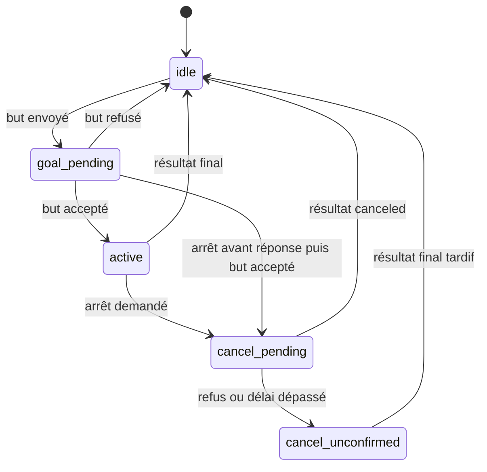

# Architecture technique

## Flux principal

1. Une chaîne UTF-8 arrive sur `/nlp_command` (`std_msgs/String`).
2. `CommandProcessor` contrôle type, vide, longueur, caractères de contrôle, négation, séquence, multiplicité et périmètre.
3. Si l’extension est activée, `OllamaLlmInterpreter` reçoit les dernières commandes acceptées et retourne un JSON contraint. Sinon, ou si le secours configuré est déclenché, `TransformersIntentClassifier` prédit l’une des trois intentions.
4. `EntityExtractor` recherche une destination unique parmi les waypoints validés et contrôle toute destination proposée par le LLM.
5. `CommandRouter` appelle une seule méthode de l’adaptateur robot.
6. `NlpCommanderNode` utilise Nav2 ou TF et publie des statuts JSON sur `/nlp_commander/status`.

## Modules

| Module | Responsabilité |
|---|---|
| `command_memory.py` | Historique SQLite local, borné et persistant des commandes acceptées |
| `llm_interpreter.py` | API Ollama locale, schéma JSON strict et liste blanche de destinations |
| `intent_classifier.py` | Chargement local du checkpoint, contrôle strict des labels, inférence |
| `entity_extractor.py` | Validation YAML, alias non ambigus, coordonnées finies, destination unique |
| `command_processor.py` | Politique de sûreté et décision indépendante de ROS 2 |
| `command_router.py` | Routage testable vers trois opérations robot |
| `navigation_state.py` | États de but et preuve d’annulation |
| `nlp_commander_node.py` | Adaptation ROS 2, ActionClient Nav2, TF et événements |

## Frontière de sûreté du LLM

Le LLM n’est jamais un agent ROS 2 et ne peut appeler aucun outil. Sa sortie autorise seulement `navigate`, `stop`, `report` ou `unknown`, une confiance, et une destination canonique issue de `waypoints.yaml`. Le processeur refuse les conflits entre le texte et le LLM, les destinations inventées et un arrêt qui n’est pas écrit explicitement.

L’inférence Ollama s’exécute hors du thread ROS principal. Un arrêt explicite est traité immédiatement, incrémente une génération de commandes et rend caduc tout résultat LLM antérieur encore en vol. Une seule analyse non prioritaire peut être active, afin d’éviter une file non bornée.

La mémoire ne constitue pas un apprentissage des poids. Elle conserve un historique borné (200 entrées par défaut) et injecte les 8 dernières commandes acceptées dans le contexte. Une référence à cet historique n’est acceptée que si le texte contient un marqueur explicite tel que `refais`, `dernière commande` ou `retourne là-bas`.

## Interfaces ROS 2

| Interface | Type | Direction |
|---|---|---|
| `/nlp_command` | `std_msgs/msg/String` | entrée |
| `/nlp_commander/status` | `std_msgs/msg/String` JSON | sortie |
| `/navigate_to_pose` | `nav2_msgs/action/NavigateToPose` | client d’action |
| `map → base_link` | TF2 | lecture |
| `/cmd_vel` | `geometry_msgs/msg/Twist` | optionnel et désactivé par défaut |

## Machine d’état Nav2

Une réponse d’annulation acceptée n’est qu’un état intermédiaire. Seul le résultat `STATUS_CANCELED`, ou l’absence de but actif, produit `stop_confirmed`.

## Configuration

`commander.yaml` impose un chemin de modèle explicite, un seuil de confiance de 0,65, une marge d’ambiguïté de 0,10 et une limite de 240 caractères. Les timeouts Nav2/TF sont positifs et validés au démarrage. Le LLM est désactivé par défaut et s’active avec `llm_enabled:=true`. Son endpoint est volontairement limité à la boucle locale (`localhost`, `127.0.0.1` ou `::1`).

Les coordonnées de `waypoints.yaml` sont des exemples. Elles sont numériques et finies, mais leur validité géométrique dépend de la carte Gazebo réellement utilisée.
