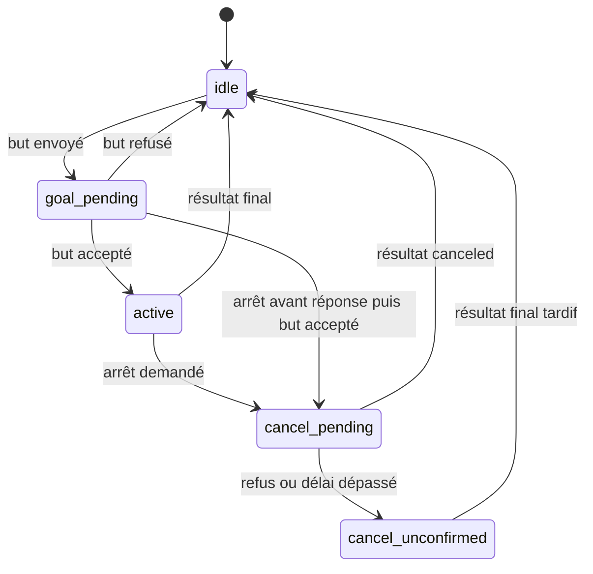

# Architecture technique

## Flux principal

1. Une chaîne UTF-8 arrive sur `/nlp_command` (`std_msgs/String`).
2. `CommandProcessor` contrôle type, vide, longueur, caractères de contrôle, négation, séquence, multiplicité et périmètre.
3. `TransformersIntentClassifier` prédit l’une des trois intentions et expose les scores.
4. `EntityExtractor` recherche une destination unique parmi les waypoints validés.
5. `CommandRouter` appelle une seule méthode de l’adaptateur robot.
6. `NlpCommanderNode` utilise Nav2 ou TF et publie des statuts JSON sur `/nlp_commander/status`.

## Modules

| Module | Responsabilité |
|---|---|
| `intent_classifier.py` | Chargement local du checkpoint, contrôle strict des labels, inférence |
| `entity_extractor.py` | Validation YAML, alias non ambigus, coordonnées finies, destination unique |
| `command_processor.py` | Politique de sûreté et décision indépendante de ROS 2 |
| `command_router.py` | Routage testable vers trois opérations robot |
| `navigation_state.py` | États de but et preuve d’annulation |
| `nlp_commander_node.py` | Adaptation ROS 2, ActionClient Nav2, TF et événements |

## Interfaces ROS 2

| Interface | Type | Direction |
|---|---|---|
| `/nlp_command` | `std_msgs/msg/String` | entrée |
| `/nlp_commander/status` | `std_msgs/msg/String` JSON | sortie |
| `/navigate_to_pose` | `nav2_msgs/action/NavigateToPose` | client d’action |
| `map → base_link` | TF2 | lecture |
| `/cmd_vel` | `geometry_msgs/msg/Twist` | optionnel et désactivé par défaut |

## Machine d’état Nav2

Une réponse d’annulation acceptée n’est qu’un état intermédiaire. Seul le résultat `STATUS_CANCELED`, ou l’absence de but actif, produit `stop_confirmed`.

## Configuration

`commander.yaml` impose un chemin de modèle explicite, un seuil de confiance de 0,65, une marge d’ambiguïté de 0,10 et une limite de 240 caractères. Les timeouts Nav2/TF sont positifs et validés au démarrage.

Les coordonnées de `waypoints.yaml` sont des exemples. Elles sont numériques et finies, mais leur validité géométrique dépend de la carte Gazebo réellement utilisée.
