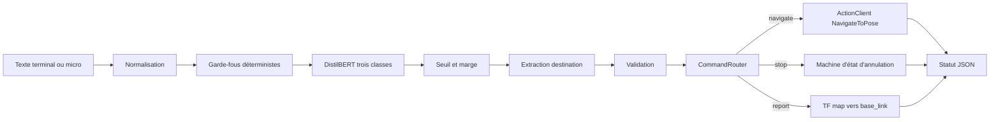

# Rapport technique final — NLP Robot Commander

**Projet HESTIM — audit et consolidation du 22 octobre 2026**

**Plateforme cible : Ubuntu 22.04, ROS 2 Humble, Nav2, TurtleBot3, Gazebo et RViz2**

**Périmètre métier final : `navigate`, `stop`, `report`**

> Les mesures de ce rapport proviennent des commandes réellement exécutées dans le dépôt. Les essais Gazebo, Nav2, TF et robot physique ne sont pas déclarés réussis : ils restent à exécuter sur la plateforme ROS 2 cible.

## Résumé exécutif

NLP Robot Commander transforme une phrase française en une décision robotique contrôlée. Le domaine est volontairement fermé : rejoindre un waypoint autorisé, interrompre une navigation ou rapporter une pose réellement disponible. La version auditée sépare normalisation, garde-fous, classification, extraction, validation, routage et adaptation ROS 2 afin qu’une erreur puisse être localisée avant toute action.

L’audit a mis en évidence une taxonomie devenue incohérente, des artefacts historiques incompatibles, un repli lexical silencieux lorsque le modèle ne chargeait pas, une annulation annoncée avant son résultat et une pose TF publiée sans contrôle de fraîcheur. Les données, le modèle, les tests et les interfaces ont été remis en cohérence autour de trois classes. Un `ActionClient` Nav2 suit désormais le but et l’annulation jusqu’au résultat ; le rapport de position refuse une TF absente ou périmée.

Les mesures finales sont : 35/36 classifications correctes sur la validation figée, 45/45 sur le test indépendant et 15/15 décisions conformes dans la campagne adversariale. Ces chiffres caractérisent un petit domaine fermé ; ils ne démontrent ni une généralisation universelle du français ni la réussite physique du robot.

## 1. Contexte, problématique et objectifs

Le projet combine Python, un classifieur DistilBERT multilingue, des règles déterministes, ROS 2 et Nav2. La difficulté n’est pas seulement de prédire une classe : une commande robotique doit aussi être complète, non niée, non ambiguë, compatible avec la configuration et exécutable par les composants disponibles.

Les objectifs vérifiables sont les suivants :

1. reconnaître exactement les trois intentions métier autorisées ;
2. refuser les entrées vides, trop longues, inconnues, niées, ambiguës ou composées ;
3. convertir une seule destination autorisée en pose `map` ;
4. traiter l’arrêt comme une commande prioritaire sans confondre demande, acceptation et confirmation ;
5. rapporter seulement une pose TF récente ;
6. produire des statuts explicites au lieu d’un plantage ou d’un faux succès ;
7. conserver les données, métriques et procédures nécessaires à la reproduction.

## 2. Périmètre fonctionnel final

| Intention | Entrée typique | Précondition | Effet |
|---|---|---|---|
| `navigate` | « Rends-toi dans la cuisine » | une destination unique de la liste blanche | envoi d’un but `NavigateToPose` |
| `stop` | « Arrête-toi immédiatement » | formulation explicite et non niée | annulation suivie jusqu’au résultat |
| `report` | « Où te trouves-tu ? » | TF `map → base_link` disponible et fraîche | publication de la pose mesurée |

Le système n’exécute ni liste d’actions ni enchaînement multi-destination. L’entrée micro reste optionnelle : elle fournit du texte au même topic, sans modifier la politique de décision.

## 3. État initial et audit technique

Avant correction, 14 tests unitaires passaient, mais ils ne couvraient pas les risques principaux. Les constats confirmés sont documentés dans `docs/audit_initial.md` :

- taxonomie non alignée entre corpus, modèle, code, exemples et résultats historiques ;
- artefacts de métriques impossibles à comparer au périmètre final ;
- retour automatique vers des règles pouvant masquer un checkpoint absent ou corrompu ;
- chemin relatif du modèle dépendant du répertoire de lancement ;
- absence de refus dédié pour négation, séquence et destinations multiples ;
- annulation Nav2 publiée comme terminée dès la requête ;
- `Twist` nul susceptible d’être présenté à tort comme preuve d’arrêt ;
- position TF sans contrôle d’âge ;
- faible couverture du routage et de la machine d’état.

Les corrections prioritaires ont été : verrouiller les trois labels, reconstruire les jeux, introduire les garde-fous, rendre le chargement défensif, isoler le routage, ajouter une machine d’état Nav2 et étendre les tests.

## 4. Architecture générale



### 4.1 Rôle des composants

| Fichier | Rôle | Invariant principal |
|---|---|---|
| `text_utils.py` | normalisation Unicode, accents, casse et espaces | représentation stable pour les règles |
| `intent_classifier.py` | inférence DistilBERT ou mode lexical explicite | ensemble des labels strictement égal au périmètre |
| `entity_extractor.py` | chargement YAML et extraction de destination | un alias ne désigne qu’un waypoint ; coordonnées finies |
| `command_processor.py` | garde-fous, confiance et production d’une décision | aucune action avant acceptation |
| `command_router.py` | dispatch vers un adaptateur robot | une seule opération par décision |
| `navigation_state.py` | suivi du but et de l’annulation | demande d’arrêt différente de confirmation |
| `nlp_commander_node.py` | topics ROS 2, action Nav2, TF et événements | erreurs et timeouts rendus visibles |
| `terminal_client.py` | saisie texte interactive | publication sur le topic configuré |
| `microphone_client.py` | transcription optionnelle | le texte suit ensuite le pipeline normal |

La séparation permet de tester le cœur sans ROS 2 et l’adaptateur avec des doubles de test. Les essais avec de vrais serveurs ROS 2 restent distincts.

## 5. NLP et DistilBERT

`distilbert-base-multilingual-cased` fournit un encodeur préentraîné multilingue. Le tokenizer convertit la phrase en identifiants et masque d’attention ; les séquences sont tronquées à 128 tokens. La tête `AutoModelForSequenceClassification` produit trois logits. Un softmax est appliqué pour obtenir des scores relatifs, mais ces scores ne sont pas considérés comme des probabilités parfaitement calibrées.

La classe au score maximal est seulement une proposition. `CommandProcessor` impose ensuite :

- un seuil configurable de 0,65 ;
- une marge configurable de 0,10 entre les deux meilleurs scores ;
- une preuve lexicale compatible pour les opérations sensibles ;
- les validations d’entité nécessaires à la navigation.

Le runtime charge tokenizer et poids avec `local_files_only=True`. Le chemin doit être absolu dans le nœud ROS 2. Les `id2label` du checkpoint doivent contenir exactement `navigate`, `stop` et `report`. Une dépendance absente, un fichier manquant, un modèle corrompu ou une taxonomie incompatible produit une `ModelLoadError`. Le classifieur lexical n’est utilisable que si le paramètre de repli est explicitement activé.

## 6. Dataset, préparation et indépendance

| Ensemble | Taille | Répartition | Usage |
|---|---:|---:|---|
| entraînement | 126 | 42 par intention | ajustement des poids |
| validation | 36 | 12 par intention | sélection du meilleur checkpoint |
| test indépendant | 45 | 15 par intention | mesure finale unique |
| sûreté | 15 | cas acceptés et refusés | comportement adversarial |

Les colonnes `intent` et `split` sont explicites dans `dataset/dataset.csv`. Le script d’entraînement refuse un fichier sans split et vérifie les classes, les doublons exacts et les recouvrements. `dataset/test_commands.csv` n’est utilisé ni pour l’entraînement ni pour la sélection. `scripts/audit_dataset.py` compare aussi les textes normalisés et les quasi-doublons inter-ensembles ; le rapport final indique zéro doublon exact et zéro paire au-dessus du seuil 0,94.

Le corpus contient impératifs, questions, politesse, formulations nominales, synonymes, commandes techniques, accents et variations de longueur. Il reste construit dans un domaine fermé et par la même équipe : un score élevé peut donc surestimer la performance auprès d’utilisateurs externes.

## 7. Méthodologie d’entraînement et de validation

| Paramètre | Valeur mesurée/configurée |
|---|---|
| modèle de base | `distilbert-base-multilingual-cased` |
| époques maximales | 12 |
| batch | 8 |
| learning rate | 2×10⁻⁵ |
| graine | 42 |
| critère de sélection | F1 macro de validation |
| checkpoint final | meilleur résultat de validation |

Le script initialise les graines Python, NumPy et PyTorch et transmet la graine au `Trainer`. Les splits figés empêchent qu’une nouvelle exécution change silencieusement la composition des jeux. Cette discipline améliore la répétabilité, sans garantir des bits identiques entre versions, matériels ou backends différents.

À chaque époque, la validation mesure accuracy et F1 macro. Le meilleur checkpoint est rechargé à la fin. Les checkpoints intermédiaires conservent seulement les poids et leur nombre est limité pour éviter plusieurs gigaoctets d’états d’optimiseur. Le dossier final est sauvegardé au format Hugging Face avec tokenizer, configuration et poids.

## 8. Résultats réellement obtenus

| Mesure | Résultat |
|---|---:|
| validation accuracy | 97,22 % — 35/36 |
| validation F1 macro | 97,22 % |
| test indépendant accuracy | 100,00 % — 45/45 |
| test indépendant F1 macro | 100,00 % |
| décisions valides acceptées | 45/45 |
| scénarios de sûreté conformes | 15/15 |
| tests unitaires | 34/34 |

La matrice de validation contient une erreur : une phrase `navigate` a été classée `stop`; les deux autres classes ont 12/12. Le test indépendant produit 15/15 par classe, avec précision, rappel et F1 à 1,00. Les fichiers bruts se trouvent dans `artifacts/training_3intents`, `artifacts/test_campaign_3intents` et `artifacts/safety_campaign_transformers`.

Ces résultats ne prouvent pas la robustesse en français ouvert. Il manque notamment plusieurs graines, une collecte auprès d’utilisateurs externes, une mesure de calibration et une campagne audio bruitée.

## 9. Normalisation, règles et extraction des paramètres

La normalisation met en minuscules, harmonise Unicode et espaces, et produit une forme sans accents pour les comparaisons. Les expressions régulières utilisent des limites de mots afin qu’un alias court ne corresponde pas au milieu d’un autre mot.

`waypoints.yaml` constitue la liste blanche. Chaque entrée possède `x`, `y`, `yaw` et des alias. Le chargeur refuse les clés racine inconnues, les noms vides, les coordonnées non finies et les alias ambigus. Aucune destination inconnue n’est convertie en coordonnées de remplacement.

Les règles de sûreté sont évaluées avant le routage :

- texte vide ou uniquement composé d’espaces ;
- dépassement de 240 caractères ;
- caractère de contrôle Unicode ;
- négation d’un déplacement ou d’un arrêt ;
- plusieurs destinations ;
- connecteur séquentiel tel que « puis » ;
- action hors périmètre ;
- intention inconnue, score faible ou marge insuffisante.

Exemples vérifiés :

| Commande | Décision attendue et obtenue |
|---|---|
| « Ne va pas dans la cuisine. » | `NEGATED_COMMAND`, aucun but |
| « Va dans la cuisine pas dans le salon. » | `MULTIPLE_DESTINATIONS`, aucun but |
| « Va dans la cuisine puis dans le laboratoire. » | `SEQUENTIAL_COMMAND`, aucun but |
| « Arrête-toi immédiatement. » | arrêt prioritaire accepté |
| « Va dans la chambre. » | `UNKNOWN_DESTINATION`, aucun but |

## 10. ROS 2, topics, actions et Nav2

| Interface | Type | Direction/usage |
|---|---|---|
| `/nlp_command` | `std_msgs/msg/String` | entrée de commande |
| `/nlp_commander/status` | `std_msgs/msg/String` JSON | événements et erreurs |
| `/navigate_to_pose` | `nav2_msgs/action/NavigateToPose` | but, résultat et annulation |
| `map → base_link` | TF2 | pose réelle du robot |
| `/cmd_vel` | `geometry_msgs/msg/Twist` | zéro optionnel, désactivé par défaut |

Le nœud valide ses paramètres au démarrage, attend le serveur d’action avec un timeout, remplit un `PoseStamped` dans le frame `map` et convertit le yaw en quaternion. Il conserve les handles et futures nécessaires au suivi asynchrone. Un nouveau but est refusé si un autre cycle n’est pas revenu à l’état libre.

Les résultats distinguent succès, annulation, refus et échec. L’absence du serveur produit `action_server_unavailable`; un but refusé produit `navigation_rejected`; une exception ou un résultat Nav2 non réussi produit un événement d’échec explicite. Le lifecycle Nav2 lui-même doit être activé et vérifié sur Ubuntu avant la démonstration.

## 11. Configuration des waypoints

Les coordonnées livrées sont des exemples dans le repère `map`. Elles ne sont pas certifiées par une carte présente dans le dépôt. Pour chaque pièce :

1. ouvrir la carte réelle dans RViz2 ;
2. placer le robot ou utiliser l’outil de but pour lire `x`, `y` et l’orientation ;
3. vérifier que la pose n’occupe ni mur ni zone gonflée du costmap ;
4. reporter les valeurs dans `src/nlp_robot_commander/config/waypoints.yaml` ;
5. relancer et tester l’accessibilité.

Les alias doivent rester uniques. Le fichier est validé au démarrage, mais seule une campagne Nav2 peut confirmer qu’une pose est physiquement atteignable.

## 12. Fonctionnement des trois opérations

### 12.1 `navigate`

La décision exige une intention suffisamment nette et exactement une destination configurée. Le routeur transmet le waypoint au nœud. Le nœud attend Nav2, envoie le but, publie son acceptation puis le résultat. Aucun succès n’est publié avant le résultat `STATUS_SUCCEEDED`.

### 12.2 `stop`

Un arrêt explicite non nié est prioritaire, même si la phrase contient d’autres mots. La machine d’état distingue :

1. `stop_received` — commande reçue ;
2. `cancellation_requested` — requête envoyée ;
3. `cancellation_accepted` — Nav2 accepte de traiter la requête ;
4. `stop_confirmed` — résultat `STATUS_CANCELED` ou absence de but actif ;
5. `stop_unconfirmed` — refus, exception, timeout ou résultat incompatible.

Un `Twist` nul est désactivé par défaut. S’il est activé après audit du multiplexeur de vitesse, il reste une mesure complémentaire et jamais une preuve d’annulation.

### 12.3 `report`

Le nœud demande la transformation `map → base_link` avec timeout. Il extrait `x`, `y`, `yaw` et calcule l’âge du timestamp. Une transformation absente, future ou plus ancienne que `max_tf_age_sec` produit respectivement un statut indisponible ou périmé. La cible de navigation n’est jamais réutilisée comme position supposée.

## 13. Sécurité et limites de la simulation

Le projet fournit des refus applicatifs, pas un arrêt d’urgence certifié. Il ne modifie aucun circuit matériel et ne doit pas remplacer les mécanismes de sécurité du robot. La sûreté effective dépend aussi du lifecycle Nav2, du contrôleur, du multiplexeur `/cmd_vel`, des capteurs, de la localisation et de l’arrêt physique.

Gazebo est utile pour vérifier les interfaces et les scénarios, mais ne reproduit pas toutes les latences, erreurs de capteur, adhérences et interactions humaines. Une démonstration fiable exige donc des traces ROS 2 et, si un robot réel est utilisé, un opérateur prêt à actionner l’arrêt matériel.

## 14. Structure du dépôt

```text
dataset/                           corpus, test indépendant et sûreté
scripts/                           audit, entraînement, évaluation, démo et PDF
src/nlp_robot_commander/           package ROS 2 Python
tests/                             tests NLP, routage et machine d’état
artifacts/training_3intents/        preuves de validation
artifacts/test_campaign_3intents/   preuves du test indépendant
artifacts/safety_campaign_*/        preuves des scénarios adversariaux
docs/                              audit, guides, rapport et checklists
output/pdf/                        rapport PDF
output/presentations/              support de soutenance
models/                            checkpoint local ignoré par Git
```

## 15. Installation reproductible

### 15.1 Cœur NLP

Python 3.10 est recommandé pour rester cohérent avec ROS 2 Humble.

```bash
python3 -m venv .venv
source .venv/bin/activate
python -m pip install --upgrade pip
python -m pip install -r requirements-dev.txt
python scripts/audit_dataset.py
python -m pytest
```

`requirements.txt` contient entraînement et analyse ; `requirements-audio.txt` contient uniquement l’entrée micro optionnelle. Les dépendances ROS 2 sont déclarées dans `package.xml` et installées avec `rosdep` dans l’environnement cible.

### 15.2 Package ROS 2

```bash
source /opt/ros/humble/setup.bash
cd /chemin/vers/NLP-Robot-Commander
rosdep install --from-paths src --ignore-src -r -y
python -m colcon build --packages-select nlp_robot_commander --symlink-install
source install/setup.bash
```

## 16. Entraînement, évaluation et preuves

```bash
python scripts/audit_dataset.py --output artifacts/dataset_audit.json

python scripts/train_intent_classifier.py \
  --output-dir models/distilbert-robot-commander-3intents \
  --artifacts-dir artifacts/training_3intents \
  --epochs 12 --batch-size 8 --seed 42

python scripts/evaluate_intent_classifier.py \
  --model models/distilbert-robot-commander-3intents \
  --output-dir artifacts/test_campaign_3intents

python scripts/evaluate_safety_commands.py \
  --model models/distilbert-robot-commander-3intents \
  --output-dir artifacts/safety_campaign_transformers

python scripts/analyze_failure_modes.py
```

Le premier téléchargement du modèle de base requiert un accès réseau. Le runtime robot utilise ensuite le checkpoint local. Les poids sont exclus du dépôt Git classique en raison de leur taille ; il faut les reproduire ou les distribuer via Git LFS ou un registre de modèles.

## 17. Lancement et diagnostic

```bash
export TURTLEBOT3_MODEL=burger
source /opt/ros/humble/setup.bash
source install/setup.bash

ros2 launch nlp_robot_commander simulation.launch.py \
  model_path:="$(realpath models/distilbert-robot-commander-3intents)" \
  map:=/chemin/absolu/vers/map.yaml
```

Dans deux autres terminaux sourcés :

```bash
ros2 run nlp_robot_commander terminal_client
ros2 topic echo /nlp_commander/status
```

Diagnostics utiles :

```bash
ros2 action list -t
ros2 action info /navigate_to_pose
ros2 lifecycle nodes
ros2 topic info /nlp_command -v
ros2 topic info /nlp_commander/status -v
ros2 run tf2_ros tf2_echo map base_link
```

Arrêter proprement avec `Ctrl+C`, puis attendre la destruction du nœud avant de fermer la simulation.

## 18. Scénario de démonstration

1. montrer Nav2 actif, la carte et la pose dans RViz2 ;
2. lancer le nœud avec un chemin absolu vers le checkpoint ;
3. envoyer une commande `navigate` vers un waypoint recalibré et montrer acceptation puis résultat ;
4. relancer une navigation et envoyer immédiatement `stop` ;
5. montrer la séquence demande, acceptation et confirmation ;
6. envoyer `report` et comparer la pose publiée à RViz2 ;
7. envoyer les trois commandes adversariales documentées et constater qu’aucun but n’est émis ;
8. tester une destination inconnue et une TF indisponible ;
9. sauvegarder console, rosbag ou captures sans transformer une observation en conclusion plus large.

La checklist détaillée se trouve dans `docs/checklist_demo.md`.

## 19. Tests exécutés et non exécutés

### Exécutés

- `python -m pytest --basetemp .pytest-tmp -q` : **34 réussis** ;
- `python -m compileall -q scripts src tests` : **succès** ;
- `python scripts/audit_dataset.py` : **audit valide**, aucune fuite détectée au seuil configuré ;
- évaluation DistilBERT : **45/45** sur le test indépendant ;
- campagne adversariale DistilBERT : **15/15** ;
- inspection visuelle page par page du PDF : **12 pages vérifiées** ;
- validation structurelle de la présentation : **12 diapositives, aucune alerte du validateur**.

### Non exécutés

- compilation `colcon` sous Ubuntu 22.04 ;
- lancement Gazebo, RViz2 et lifecycle Nav2 ;
- navigation réelle vers les quatre waypoints ;
- annulation d’un but avec immobilisation observée ;
- tests TF absent/périmé sur un graphe ROS 2 réel ;
- microphone en environnement bruité ;
- robot physique et arrêt matériel.

La machine de travail est Windows et ne fournit pas la pile ROS 2 Humble/Gazebo cible. Les mocks prouvent la politique de routage et les transitions pures, pas le bon fonctionnement d’un réseau ROS 2 réel.

## 20. Problèmes corrigés et modes d’échec

Le tableau complet est dans `docs/failure_mode_catalogue.md`. Les corrections majeures sont :

| Problème initial | Correction | Preuve |
|---|---|---|
| classes incohérentes | taxonomie centralisée et vérifiée au chargement | tests dataset/modèle |
| repli silencieux | repli désactivé par défaut | test modèle absent |
| commandes dangereuses | négation, séquence, ambiguïté et entités validées | campagne de sûreté |
| arrêt annoncé trop tôt | machine d’état jusqu’au résultat Nav2 | tests `navigation_state` |
| position potentiellement périmée | timeout et âge maximal TF | code et statuts dédiés |
| peu de couverture | 34 tests, routeur mocké et états purs | sortie `pytest` |

## 21. Limites restantes et améliorations futures

- collecter un test auprès de locuteurs externes ;
- exécuter au moins cinq graines et publier moyenne et dispersion ;
- mesurer calibration, latence CPU et consommation mémoire sur le robot ;
- constituer un corpus audio bruité séparé ;
- ajouter des tests d’intégration ROS 2 dans une CI Ubuntu 22.04 ;
- enregistrer les résultats Nav2 et TF dans des rosbags ;
- utiliser Git LFS ou un registre versionné si les poids doivent être distribués ;
- revoir seuil et marge après collecte réelle, sans utiliser le test final pour les régler.

## 22. Actions manuelles restantes

Les opérations nécessitant Ubuntu, la carte ou le matériel sont ordonnées et détaillées dans `docs/ACTIONS_MANUELLES.md`. Elles couvrent l’installation, le checkpoint, le recalibrage, Gazebo/Nav2, l’arrêt, TF, le microphone, le robot réel et les preuves de soutenance.

## Conclusion

Le cœur NLP est cohérent avec les trois intentions, les jeux sont séparés, les résultats sont reproductibles à partir des scripts et les principaux refus de sécurité sont testés. L’intégration ROS 2 a été renforcée sans inventer de succès de navigation. Le projet est prêt pour sa dernière phase : exécuter la campagne manuelle sur Ubuntu 22.04, recalibrer les waypoints et intégrer uniquement les preuves réellement observées.

## Annexe A — Paramètres importants

| Paramètre | Valeur par défaut | Rôle |
|---|---:|---|
| `classifier_backend` | `transformers` | backend d’inférence |
| `confidence_threshold` | `0.65` | score minimal |
| `ambiguity_margin` | `0.10` | écart minimal top-1/top-2 |
| `max_command_chars` | `240` | limite d’entrée |
| `nav_server_timeout_sec` | `3.0` | attente de Nav2 |
| `cancel_timeout_sec` | `3.0` | délai d’annulation |
| `tf_timeout_sec` | `0.5` | attente TF |
| `max_tf_age_sec` | `1.0` | âge maximal de pose |
| `publish_zero_velocity_on_stop` | `false` | mesure complémentaire optionnelle |

## Annexe B — Références techniques

- ROS 2 Humble, installation Ubuntu : <https://docs.ros.org/en/humble/Installation/Ubuntu-Install-Debs.html>
- ROS 2 Humble, launch files : <https://docs.ros.org/en/ros2_documentation/humble/How-To-Guides/Launch-file-different-formats.html>
- Nav2, action `NavigateToPose` : <https://docs.nav2.org/rolling/configuration_and_development/configuration_guide/core_servers/bt_plugins/actions/NavigateToPose/>
- Hugging Face, DistilBERT : <https://huggingface.co/docs/transformers/en/model_doc/distilbert>
- Hugging Face, classification de texte : <https://huggingface.co/docs/transformers/main/tasks/sequence_classification>
- PyTorch, reproductibilité : <https://docs.pytorch.org/docs/stable/notes/randomness.html>
